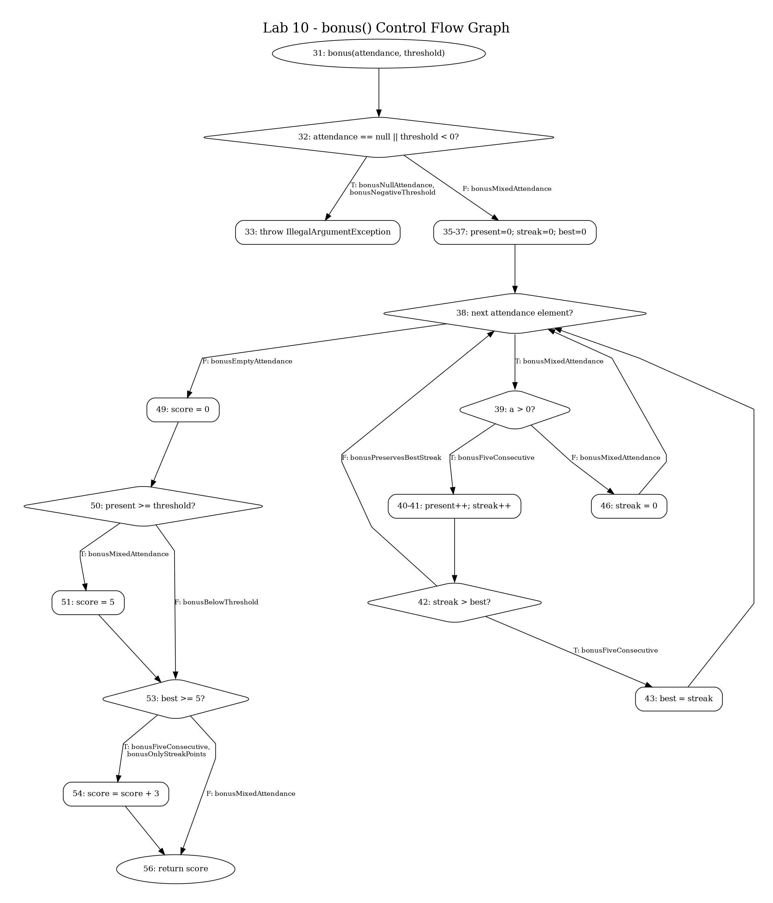

# Лаборатори №10 — Өгөгдлийн урсгалын тест

**Хичээл:** F.CSA313 
**Оюутан:** Шийрэвнинж  
**Оюутны код:** B232270049


## Ашигласан орчин

### Java хувилбар

```text
openjdk version "21.0.13" 2026-10-20
OpenJDK Runtime Environment (build 21.0.13+9-1-deb13u2-Debian)
OpenJDK 64-Bit Server VM (build 21.0.13+9-1-deb13u2-Debian, mixed mode, sharing)
```

### Maven хувилбар

```text
Apache Maven 3.9.9
Maven home: /usr/share/maven
Java version: 21.0.13, vendor: Debian, runtime: /usr/lib/jvm/java-21-openjdk-amd64
Default locale: en_US, platform encoding: UTF-8
OS name: "linux", version: "6.12.117+deb13-amd64", arch: "amd64", family: "unix"
```

## A. gcd() функцийн DU анализ

### A1. Definition ба Use

- Definition (def): Хувьсагчид утга оноох үйлдэл.
- c-use: Тооцоолол эсвэл return-д хувьсагч ашиглах.
- p-use: Нөхцөл шалгахад хувьсагч ашиглах.
- Def-clear path: Def-ээс use хүртэл тухайн хувьсагч дахин тодорхойлогдоогүй зам.

### A2. DU хосууд

| Хувьсагч | Def мөр | Use мөр | Төрөл | Def-clear зам | Тестийн ID | Хамрагдсан |
|---|---|---|---|---|---|---|
| x | 13 | 16 | c-use | 13→15(T)→16 | gcdTwoIterations | Тийм |
| x | 13 | 20 | c-use | 13→15(F)→20 | gcdZeroIterations | Тийм |
| x | 17 | 16 | c-use | 17→18→15(T)→16 | gcdTwoIterations | Тийм |
| x | 17 | 20 | c-use | 17→18→15(F)→20 | gcdOneIteration | Тийм |
| y | 13 | 15(T) | p-use | 13→15(T) | gcdOneIteration | Тийм |
| y | 13 | 15(F) | p-use | 13→15(F) | gcdZeroIterations | Тийм |
| y | 13 | 16 | c-use | 13→15(T)→16 | gcdTwoIterations | Тийм |
| y | 13 | 17 | c-use | 13→15(T)→16→17 | gcdTwoIterations | Тийм |
| y | 18 | 15(T) | p-use | 18→15(T) | gcdTwoIterations | Тийм |
| y | 18 | 15(F) | p-use | 18→15(F) | gcdOneIteration | Тийм |
| y | 18 | 16 | c-use | 18→15(T)→16 | gcdTwoIterations | Тийм |
| y | 18 | 17 | c-use | 18→15(T)→16→17 | gcdTwoIterations | Тийм |
| tmp | 16 | 18 | c-use | 16→17→18 | gcdOneIteration | Тийм |

### A3. JUnit тестүүд

| Тест | Оролт | Хүлээгдэх үр дүн |
|---|---|---|
| gcdZeroIterations | gcd(7,0) | 7 |
| gcdOneIteration | gcd(0,5) | 5 |
| gcdTwoIterations | gcd(12,8) | 4 |

`gcd(7,0)` нь давталтгүй замыг шалгана.

`gcd(12,8)` нь хоёр давталт гүйцэтгэж, өмнөх давталтад тодорхойлогдсон хувьсагч дараагийн давталтад ашиглагдах DU хосуудыг хамарна.

### A4. Тестийн үр дүн

- Tests run: 3
- Failures: 0
- Errors: 0
- Skipped: 0
- BUILD SUCCESS

JaCoCo-ийн одоогийн үр дүн:

- Branch covered: 2/16
- Line covered: 5/24

Эдгээр нь зөвхөн gcd() тестүүд ажилласан үеийн бүх классын хамралт юм. bonus() тестүүдийг нэмсний дараа өснө.

## B. bonus() функцийн өгөгдлийн урсгалын шинжилгээ


### B0. bonus() функцийн Control Flow Graph (CFG)

`bonus()` функцийн удирдлагын урсгалыг Graphviz
ашиглан дүрсэлсэн.



CFG-д:
- 32-р мөрийн оролтын шалгалт;
- 38-р мөрийн `for` давталт;
- 39-р мөрийн ирцийн шалгалт;
- 42-р мөрийн дараалсан ирцийн шалгалт;
- 46-р мөрийн `streak` хувьсагчийн дахин тодорхойлолт;
- 50, 53-р мөрийн оноо тооцох нөхцөлүүдийг харуулсан.

Зангилаануудад эх кодын мөрийн дугаар,
нөхцөлийн ирмэгүүдэд True/False болон
тухайн замыг хамарсан JUnit тестийн нэрийг
тэмдэглэсэн.

CFG-ийн эх файл: `cfg-bonus.dot`
Зураг: `cfg-bonus.png`

### B1. Хувьсагчдын Definition ба Use

| Хувьсагч | Definition мөр | Use мөр |
|---|---|---|
| attendance | 31 (параметр) | 32, 38 |
| threshold | 31 (параметр) | 32, 50 |
| a | 38 | 39 |
| present | 35, 40 | 40, 50 |
| streak | 36, 41, 46 | 41, 42, 43 |
| best | 37, 43 | 42, 53 |
| score | 49, 51, 54 | 54, 56 |

### B2. DU хосууд ба тестийн хамралт


| Хувьсагч | Def → Use | Төрөл | Def-clear зам | Тест | Хамрагдсан |
|---|---|---|---|---|---|
| attendance | 31 → 32 | p-use | 31→32 | bonusNullAttendance | Тийм |
| attendance | 31 → 38 | c-use | 31→32(F)→35→36→37→38 | bonusMixedAttendance | Тийм |
| threshold | 31 → 32 | p-use | 31→32 | bonusNegativeThreshold | Тийм |
| threshold | 31 → 50 | p-use | 31→32(F)→35→36→37→38(F)→49→50 | bonusEmptyAttendance | Тийм |
| a | 38 → 39(T) | p-use | 38(T)→39(T) | bonusFiveConsecutive | Тийм |
| a | 38 → 39(F) | p-use | 38(T)→39(F) | bonusMixedAttendance | Тийм |
| present | 35 → 40 | c-use | 35→38(T)→39(T)→40 | bonusMixedAttendance | Тийм |
| present | 35 → 50(T) | p-use | 35→38(F)→49→50(T) | bonusEmptyAttendance | Тийм |
| present | 35 → 50(F) | p-use | 35→38(F)→49→50(F) | bonusEmptyBelowThreshold | Тийм |
| present | 40 → 40 | c-use | 40→38(T)→39(T)→40 | bonusFiveConsecutive | Тийм |
| present | 40 → 50(T) | p-use | 40→38(F)→49→50(T) | bonusMixedAttendance | Тийм |
| present | 40 → 50(F) | p-use | 40→38(F)→49→50(F) | bonusBelowThreshold | Тийм |
| streak | 36 → 41 | c-use | 36→38(T)→39(T)→41 | bonusMixedAttendance | Тийм |
| streak | 41 → 41 | c-use | 41→42→43→38(T)→39(T)→41 | bonusFiveConsecutive | Тийм |
| streak | 41 → 42(T) | p-use | 41→42(T) | bonusFiveConsecutive | Тийм |
| streak | 41 → 42(F) | p-use | 41→42(F) | bonusPreservesBestStreak | Тийм |
| streak | 41 → 43 | c-use | 41→42(T)→43 | bonusFiveConsecutive | Тийм |
| streak | 46 → 41 | c-use | 46→38(T)→39(T)→41 | bonusMixedAttendance | Тийм |
| best | 37 → 42(T) | p-use | 37→38(T)→39(T)→40→41→42(T) | bonusFiveConsecutive | Тийм |
| best | 43 → 42(T) | p-use | 43→38(T)→39(T)→40→41→42(T) | bonusFiveConsecutive | Тийм |
| best | 43 → 42(F) | p-use | 43→38(T)→39(T)→40→41→42(F) | bonusPreservesBestStreak | Тийм |
| best | 37 → 53(F) | p-use | 37→38(F)→49→50→53(F) | bonusEmptyAttendance | Тийм |
| best | 43 → 53(T) | p-use | 43→38(F)→49→50→53(T) | bonusFiveConsecutive | Тийм |
| best | 43 → 53(F) | p-use | 43→38(F)→49→50→53(F) | bonusMixedAttendance | Тийм |
| score | 49 → 54 | c-use | 49→50(F)→53(T)→54 | bonusOnlyStreakPoints | Тийм |
| score | 49 → 56 | c-use | 49→50(F)→53(F)→56 | bonusBelowThreshold | Тийм |
| score | 51 → 54 | c-use | 51→53(T)→54 | bonusFiveConsecutive | Тийм |
| score | 51 → 56 | c-use | 51→53(F)→56 | bonusMixedAttendance | Тийм |
| score | 54 → 56 | c-use | 54→56 | bonusFiveConsecutive | Тийм |


### B3. Kill ба боломжгүй DU хосууд

46-р мөрийн `streak = 0` үйлдэл нь өмнөх
`streak` definition-ийг kill хийнэ.

Жишээ def-clear зам:

`46 → 38(T) → 39(T) → 41`

Энэ замд 46-р мөрийн утгыг 41-р мөрийн
баруун талд ашиглаж байна.

Харин `46 → 42` нь боломжгүй DU хос.
Учир нь 42-р мөрд хүрэхээс өмнө 41-р мөрөнд
`streak` дахин тодорхойлогдоно.

Мөн `36 → 42` хос def-clear замгүй.


Мөн `46 → 43` нь боломжгүй DU хос юм.
Учир нь 43-р мөрөнд хүрэхийн өмнө 41-р мөрөнд
`streak` дахин тодорхойлогдоно.

`41 → 41` нь loop-carried DU хос бөгөөд
нэг давталтад тодорхойлогдсон `streak`-ийн
утга дараагийн давталтын 41-р мөрийн
баруун талд ашиглагдана.


### B4. All-defs ба all-DU шатны үр дүн

| Үзүүлэлт | All-defs | All-DU |
|---|---|---|
| JUnit тест | 9 | 11 |
| Failures | 0 | 0 |
| Branch covered | 16/16 | 16/16 |
| Branch missed | 0 | 0 |
| Line covered | 23/24 | 23/24 |
| Build | SUCCESS | SUCCESS |

All-defs нотолгоо:
- results/mvn-verify-alldefs.txt
- results/jacoco-alldefs.csv

All-DU нотолгоо:
- results/mvn-verify-alldu.txt
- results/jacoco-alldu.csv

JaCoCo нь branch болон line coverage хэмждэг.
DU-pairs хамралтыг def-clear зам болон
JUnit тестүүдээр тусад нь шинжилсэн.


## C. Mutation Testing

### C1. Туршилтын зорилго

Mutation Testing нь эх кодод зориудаар жижиг өөрчлөлт оруулж, JUnit тестүүд тухайн алдааг илрүүлж чадах эсэхийг шалгах арга юм.

### C2. Mutation Testing-ийн үр дүн

| ID | Өөрчлөлт | Тестийн үр дүн | Төлөв |
|---|---|---|---|
| M1 | `streak = streak + 1` мөрийг устгасан | 12 тестээс 3 нь алдаа илрүүлсэн | KILLED |
| M2 | `best = streak`-ийг `best = present` болгосон | Эхний 12 тест бүгд давсан | SURVIVED |
| M2-kill | M2-д зориулсан шинэ тест нэмсэн | 13 тестээс 1 нь алдаа илрүүлсэн | KILLED |
| M3 | `int total = present + best;` мөр нэмсэн | 13 тест бүгд давсан | SURVIVED |

### C3. M1 — Дараалсан ирцийн тооцооллын алдаа

`streak = streak + 1` мөрийг устгахад дараах тестүүд алдаа илрүүлсэн:

- `bonusFiveConsecutive`
- `bonusPreservesBestStreak`
- `bonusOnlyStreakPoints`

Иймээс M1 mutant-ийг KILLED гэж дүгнэсэн.

### C4. M2 — Хамгийн урт дарааллыг буруу тооцох

`best = present` өөрчлөлтийг эхний 12 тест илрүүлээгүй.

Үүнийг илрүүлэхийн тулд `bonusDetectsIncorrectBest()` тест нэмсэн.

Оролт: `[1, 1, 0, 1, 1, 1]`, threshold = 6.

Зөв код 0 оноо буцаах боловч M2 алдаатай код 3 оноо буцаасан.

Шинэ тест алдааг илрүүлсэн тул M2 mutant KILLED болсон.

### C5. M3 — Ашиглагдахгүй хувьсагч

`int total = present + best;` мөр нэмэхэд 13 тест бүгд амжилттай ажилласан.

Учир нь `total` хувьсагчийг цааш ашиглаагүй бөгөөд функцийн буцаах үр дүн өөрчлөгдөөгүй.

Энэ асуудлыг JUnit тестээс илүүтэй static analysis эсвэл IDE-ийн анхааруулгаар илрүүлэх боломжтой.

### C6. Нотолгооны файлууд

- `results/mvn-test-M1.txt`
- `results/mvn-test-M2.txt`
- `results/mvn-test-M2-kill.txt`
- `results/mvn-test-M3.txt`

Mutation туршилт бүрийн дараа эх кодын өөрчлөлтийг сэргээсэн. M2-г илрүүлэх шинэ JUnit тестийг эцсийн хувилбарт хадгалсан.

## D. Эцсийн үр дүн ба дүгнэлт

### D1. Эцсийн тестийн үр дүн

| Үзүүлэлт | Үр дүн |
|---|---|
| Нийт JUnit тест | 13 |
| Амжилттай тест | 13 |
| Алдаатай тест | 0 |
| Branch coverage | 100% (16/16) |
| Line coverage | 95.83% (23/24) |
| Instruction coverage | 96.30% (78/81) |
| Maven build | SUCCESS |

Нотолгоо:
- `results/mvn-verify-final.txt`
- `results/jacoco-final.csv`

### D2. Дүгнэлт

Энэхүү лабораторийн ажлаар `gcd()` болон `bonus()` функцүүдийн өгөгдлийн урсгалд шинжилгээ хийлээ. Хувьсагчдын Definition болон Use цэгүүдийг тодорхойлж, def-clear замуудыг судалсан. All-defs болон All-DU-pairs шалгуурт тулгуурлан JUnit тестүүдийг боловсруулсан. Mutation Testing-ийн хүрээнд M1, M2, M3 гэсэн гурван өөрчлөлтийг туршсан. M1 өөрчлөлтийг одоо байгаа тестүүд илрүүлсэн бол M2 өөрчлөлтийг илрүүлэхийн тулд нэмэлт тест боловсруулсан. Харин M3 өөрчлөлт нь программын үр дүнд нөлөөлөөгүй учраас тестүүдээр илрээгүй бөгөөд static analysis ашиглах шаардлагатайг харуулсан. Эцсийн байдлаар 13 JUnit тест амжилттай ажиллаж, JaCoCo-ийн branch coverage 100%-д хүрсэн. Ингэснээр өгөгдлийн урсгалын шинжилгээ, тестийн хамралт болон mutation testing-ийн ялгааг практикт судаллаа.

### D3. AI хэрэгслийн ашиглалт

Лабораторийн ажлыг гүйцэтгэх явцад ChatGPT ашиглан DU шинжилгээний ойлголт, JUnit тестийн загвар, Mutation Testing-ийн үр дүн болон тайлангийн бүтэц боловсруулахад туслалцаа авсан. Кодын өөрчлөлт, тестийн ажиллуулалт, үр дүнгийн баталгаажуулалтыг Debian орчинд гүйцэтгэсэн.
