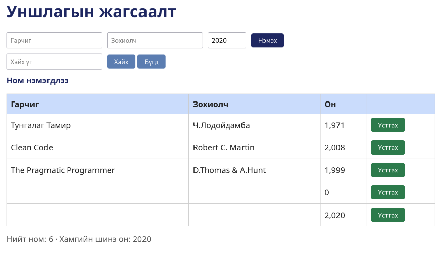

# BUG-01 — Заавал бөглөх талбаруудын баталгаажуулалт ажиллахгүй

**Severity:** High  
**Tour:** Couch Potato  
**Орчин:** Debian Linux, Firefox 140.10.1esr, Node.js v20.19.2

## Тайлбар

Ном нэмэх үед гарчиг, зохиолч, он гэсэн заавал бөглөх талбаруудыг хоосон үлдээсэн ч систем номыг жагсаалтад нэмж байна.

## Дахин гаргах алхам

1. Аппликейшнийг `node app.js` командаар шинээр ажиллуулна.
2. Firefox ашиглан `http://localhost:3000` хаягаар орно.
3. Гарчиг, зохиолч, он талбаруудыг хоосон үлдээнэ.
4. Ном нэмэх товчийг дарна.
5. Номын жагсаалтыг шалгана.

## Хүлээгдэж буй үр дүн

Заавал бөглөх талбарууд хоосон байгаа тул ном нэмэгдэхгүй, хэрэглэгчид баталгаажуулалтын алдааны мэдээлэл харагдах ёстой.

## Бодит үр дүн

Бүх талбар хоосон байсан ч ном жагсаалтад нэмэгдэж байна.

## Нотолгоо

