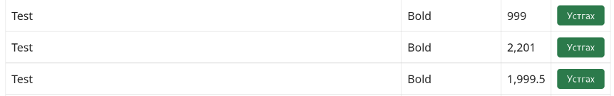

# BUG-02 — Номын оны баталгаажуулалт ажиллахгүй

**Severity:** High  
**Tour:** Couch Potato  
**Орчин:** Debian Linux, Firefox 140.10.1esr, Node.js v20.19.2

## Тайлбар

Номын хэвлэгдсэн он 1000–2100 хоорондох бүхэл тоо байх ёстой боловч систем энэ нөхцөлийг хангахгүй утгуудыг зөвшөөрч байна.

## Дахин гаргах алхам

1. Аппликейшнийг `node app.js` командаар шинээр ажиллуулна.
2. `http://localhost:3000` хаягаар орно.
3. Гарчигт `test`, зохиолчид `Bold`, онд `999` гэж оруулж ном нэмнэ.
4. Дараа нь ижил гарчиг, зохиолчтой номын онд `2201` гэж оруулж нэмнэ.
5. Мөн онд `1999.5` гэж оруулж нэмнэ.
6. Номын жагсаалтыг шалгана.

## Хүлээгдэж буй үр дүн

1000-аас бага, 2100-аас их болон бутархай онтой ном нэмэгдэхгүй байх ёстой.

## Бодит үр дүн

`999`, `2201`, `1999.5` гэсэн утгуудтай номууд жагсаалтад нэмэгдсэн.

## Нотолгоо

[bug-02.md](bug-02.md)