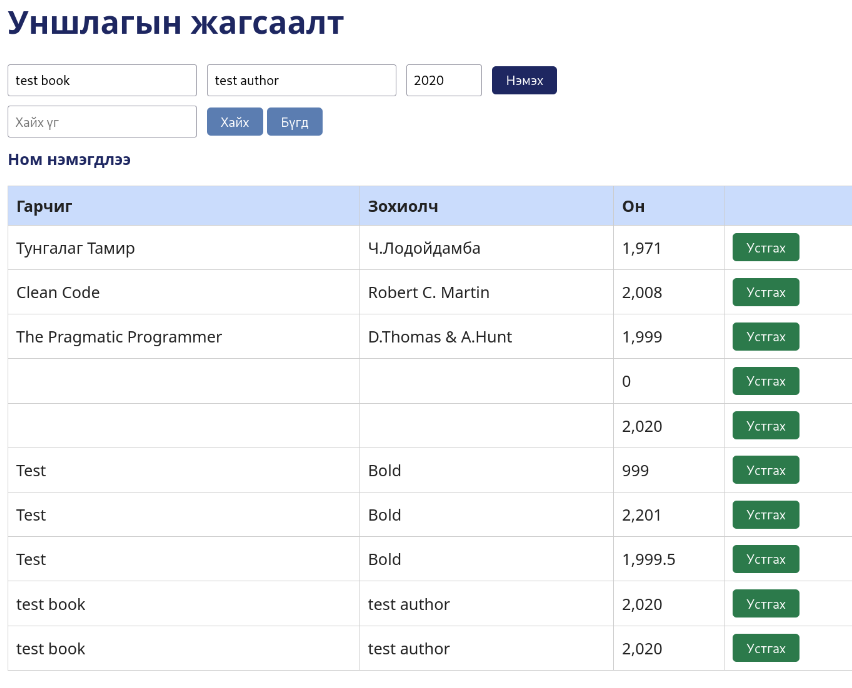

# BUG-03 — Давхардсан ном нэмэгдэж байна

**Severity:** Medium  
**Tour:** Couch Potato  
**Орчин:** Debian Linux, Firefox 140.10.1esr, Node.js v20.19.2

## Тайлбар

Ижил гарчиг болон зохиолчтой номыг давхардуулан нэмэх боломжтой байна.

## Дахин гаргах алхам

1. Аппликейшнийг `node app.js` командаар шинээр ажиллуулна.
2. `http://localhost:3000` хаягаар орно.
3. Гарчигт `test book`, зохиолчид `test author`, онд `2020` гэж оруулна.
4. Ном нэмэх товчийг дарна.
5. Яг ижил өгөгдлөөр дахин ном нэмнэ.
6. Жагсаалтыг шалгана.

## Хүлээгдэж буй үр дүн

Ижил гарчиг, зохиолчтой ном өмнө нь бүртгэгдсэн бол давхардуулан нэмэхгүй байх ёстой.

## Бодит үр дүн

`test book` гарчигтай, `test author` зохиолчтой, `2020` онтой ном хоёр удаа нэмэгдсэн.

## Нотолгоо

