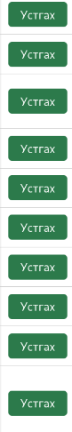

# BUG-04 — Устгах товчны өнгө шаардлага хангахгүй

**Severity:** Low  
**Tour:** Supermodel  
**Орчин:** Debian Linux, Firefox 140.10.1esr, Node.js v20.19.2

## Тайлбар

Спецификацийн дагуу ном устгах товч улаан өнгөтэй байх ёстой боловч ногоон өнгөөр харагдаж байна.

## Дахин гаргах алхам

1. Аппликейшнийг `node app.js` командаар шинээр ажиллуулна.
2. Firefox ашиглан `http://localhost:3000` хаягаар орно.
3. Номын жагсаалтыг харна.
4. Ном бүрийн хажууд байрлах устгах товчны өнгийг шалгана.

## Хүлээгдэж буй үр дүн

Устгах товч улаан өнгөтэй байх ёстой.

## Бодит үр дүн

Устгах товч ногоон өнгөтэй харагдаж байна.

## Нотолгоо

