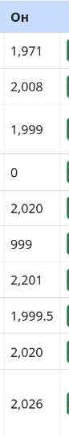

# BUG-05 — Номын он буруу форматтай харагдаж байна

**Severity:** Low  
**Tour:** Supermodel  
**Орчин:** Debian Linux, Firefox 140.10.1esr, Node.js v20.19.2

## Тайлбар

Номын хэвлэгдсэн он нь бүхэл тоогоор, мянгатын тусгаарлагчгүй харагдах ёстой боловч таслалтай форматтай байна.

## Дахин гаргах алхам

1. Аппликейшнийг `node app.js` командаар шинээр ажиллуулна.
2. `http://localhost:3000` хаягаар орно.
3. Номын жагсаалт дахь хэвлэгдсэн оныг шалгана.
4. `1971` оныг хэрхэн харуулж байгааг ажиглана.

## Хүлээгдэж буй үр дүн

Номын он `1971` гэсэн форматтай харагдах ёстой.

## Бодит үр дүн

Номын он `1,971` гэсэн форматтай харагдаж байна.

## Нотолгоо

