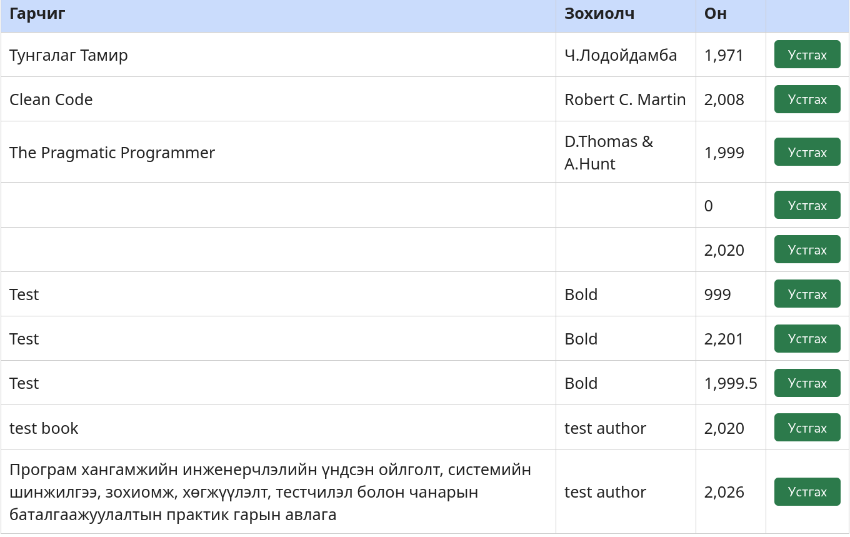

# BUG-06 — Урт гарчиг хүснэгтийн байрлалыг эвдэж байна

**Severity:** Medium  
**Tour:** Supermodel  
**Орчин:** Debian Linux, Firefox 140.10.1esr, Node.js v20.19.2

## Тайлбар

Урт гарчигтай ном нэмэхэд хүснэгтийн байрлал алдагдаж, хуудасны хэвийн харагдах байдал эвдэрч байна.

## Дахин гаргах алхам

1. Аппликейшнийг `node app.js` командаар шинээр ажиллуулна.
2. `http://localhost:3000` хаягаар орно.
3. Гарчиг талбарт дараах текстийг оруулна:

   `Програм хангамжийн инженерчлэлийн үндсэн ойлголт, системийн шинжилгээ, зохиомж, хөгжүүлэлт, тестчилэл болон чанарын баталгаажуулалтын практик гарын авлага`

4. Зохиолчид `Bold`, онд `2020` гэж оруулна.
5. Ном нэмэх товчийг дарна.
6. Хүснэгтийн байрлалыг шалгана.

## Хүлээгдэж буй үр дүн

Урт гарчигтай ном нэмсэн ч хүснэгтийн байрлал алдагдахгүй, текст баганын хэмжээнд тохирч харагдах ёстой.

## Бодит үр дүн

Урт гарчиг нэмэхэд хүснэгт хажуу тийш сунаж, байрлал нь эвдэрсэн.

## Нотолгоо

