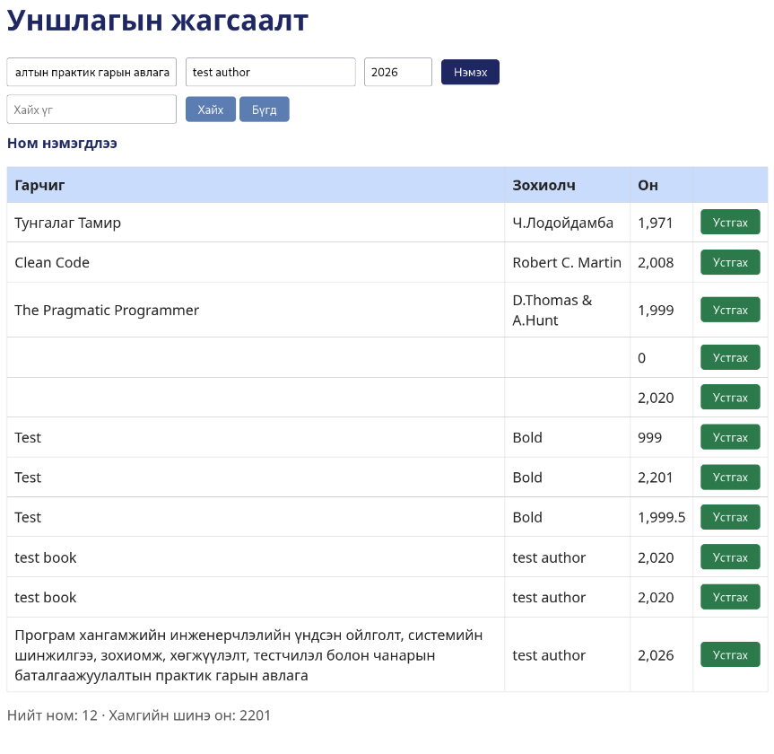

# BUG-07 — Нийт номын тоолуур хүснэгтийн гарчгийг давхар тоолж байна

**Severity:** Medium  
**Tour:** Supermodel  
**Орчин:** Debian Linux, Firefox 140.10.1esr, Node.js v20.19.2

## Тайлбар

Номын нийт тоог харуулах үед систем хүснэгтийн баганын гарчгийн мөрийг номын нэг мөр гэж тооцож, бодит номын тооноос 1-ээр илүү харуулж байна.

## Дахин гаргах алхам

1. Аппликейшнийг `node app.js` командаар шинээр ажиллуулна.
2. Firefox ашиглан `http://localhost:3000` хаягаар орно.
3. Хүснэгтэд байгаа номын мөрүүдийг баганын гарчгийн мөрийг оруулахгүйгээр тоолно.
4. Хүснэгтийн дээр харагдаж буй нийт номын тоолууртай харьцуулна.
5. Нэг ном нэмж эсвэл устгаад тоолуурыг дахин шалгана.

## Хүлээгдэж буй үр дүн

Нийт номын тоолуур зөвхөн номын мэдээлэл агуулсан мөрүүдийг тоолж, хүснэгтийн баганын гарчгийн мөрийг тооцохгүй байх ёстой.

## Бодит үр дүн

Хүснэгтэд 11 ном байхад нийт номын тоолуур 12 гэж харагдсан. Баганын гарчгийн мөрийг нэг ном гэж тооцож байгаа тул нийт тоо бодит номын тооноос 1-ээр илүү байна.

## Нотолгоо

