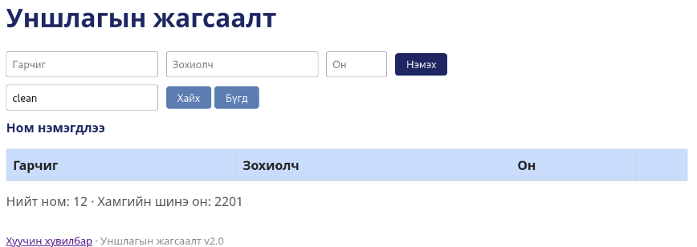

# BUG-08 — Гарчиг, зохиолчийн хэсэгчилсэн хайлт ажиллахгүй

**Severity:** Medium  
**Tour:** Couch Potato  
**Орчин:** Debian Linux, Firefox 140.10.1esr, Node.js v20.19.2

## Тайлбар

Номын гарчиг болон зохиолчийн нэрийн хэсгийг оруулж хайхад тохирох ном олдохгүй байна. Туршилтын явцад бүтэн нэрээр хайхад үр дүн гарч байгаа гэж ажиглагдсан.

## Дахин гаргах алхам

1. Аппликейшнийг `node app.js` командаар шинээр ажиллуулна.
2. `http://localhost:3000` хаягаар орно.
3. Жагсаалтад `Clean Code` ном байгаа эсэхийг шалгана.
4. Хайлтын талбарт `clean` гэж бичээд хайна.
5. Дараа нь зохиолчийн нэрийн хэсэг болох `martin` гэж бичээд хайна.
6. Хайлтын үр дүнг шалгана.

## Хүлээгдэж буй үр дүн

Хайлтын шаардлагын дагуу том, жижиг үсгийн ялгааг үл харгалзан гарчиг болон зохиолчоор хайлт хийх ёстой.

## Бодит үр дүн

`clean` гэж хайхад `Clean Code` ном олдоогүй. `martin` гэж хайхад мөн зохиолчийн нэрээр тохирох ном олдоогүй.

## Нотолгоо

**Тайлбар:** Хэсэгчилсэн хайлт заавал дэмжих ёстой эсэхийг спецификацитай тулгаж шалгана. Харин бүтэн нэрийг том, жижиг үсгээр өөрчилж хайхад үр дүн гарахгүй байвал case-insensitive хайлтын шаардлагыг зөрчсөн нь батлагдана.

