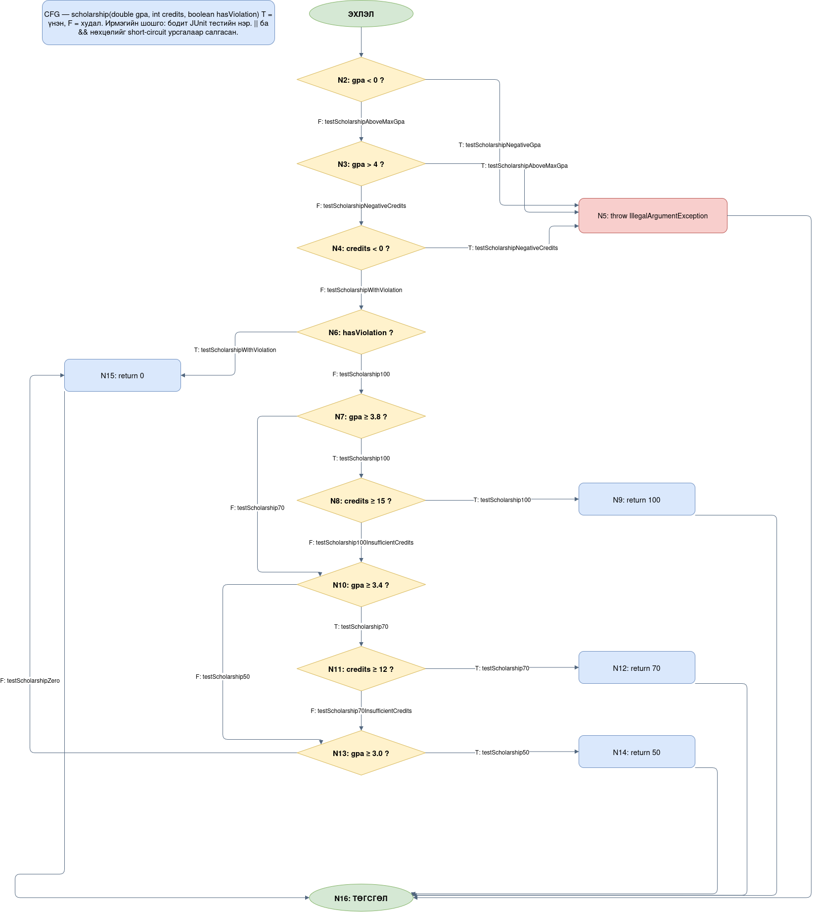

# Лаборатори №9 — JaCoCo код хамралт

**Оюутан:** Х.Шийрэвнинж  
**Оюутны код:** B232270049  
**Хичээл:** F.CSA313 

## Хэсэг A — Happy path тест ба анхны хамралт

ScholarshipCalculator классын гурван функцийг шалгах
зорилгоор нийт 5 хэвийн урсгалын тест бичиж ажиллуулав.

### Тестийн үр дүн

- Нийт тест: 5
- Амжилттай: 5
- Алдаа: 0
- Line coverage: 60% (15/25)
- Branch coverage: 48.78% (20/41)
- Instruction coverage: 67.11% (102/152)

### Хамралтын ажиглалт

JaCoCo тайлангаас харахад хэвийн оролтын тестүүд
үндсэн үйлдлүүдийг шалгасан боловч бүх нөхцөлийн
салааг хамраагүй байна.

Одоогийн тестүүдэд буруу оролтын үед exception
шидэх замууд, сахилгын зөрчилтэй нөхцөл болон
зарим үнэлгээний салаанууд шалгагдаагүй байна.

Дараагийн хэсэгт нэмэлт тестүүд бичиж Line болон
Branch хамралтыг 100% хүргэнэ.

## Хэсэг B — Code Coverage 100% болгох

Хэсэг A-ийн үр дүнд үндэслэн хамрагдаагүй нөхцөлүүдийг тодорхойлж, нэмэлт JUnit 5 тестүүд бичсэн.

`letterGrade()`, `gpa()`, `scholarship()` функцүүдийн салаалалт, буруу оролт болон exception үүсэх тохиолдлуудыг шалгасан.

### Тестийн үр дүн

- Нийт тест: 23
- Амжилттай: 23
- Алдаа: 0
- Line Coverage: 100% (25/25)
- Branch Coverage: 100% (41/41)
- Instruction Coverage: 100% (152/152)

### CFG зураглал

`scholarship()` функцийн Control Flow Graph (CFG)-ийг зурж, нөхцөл бүрийн True/False салаалалт болон тухайн салааг шалгах тестийн нэрийг тэмдэглэсэн.

### Нотолгоо

- `results/mvn-verify-B.txt`
- `results/jacoco-B.csv`
- `cfg.png`

Хэсэг B-ийн үр дүнд бүх мөр болон салаалалтыг тестээр хамруулсан.

## Хэсэг C — Loop Boundary Testing

`gpa()` функцийн `for` давталтын хилийн тохиолдлуудыг JUnit 5 ашиглан шалгав.

### Тестийн тохиолдлууд

| Тест | Оролт | Хүлээгдэж буй үр дүн |
|---|---|---|
| testGpaNull | null | IllegalArgumentException |
| testGpaEmpty | [] | IllegalArgumentException |
| testGpaSingleElement | [95] | 4.0 |
| testGpaMultipleElements | [95, 85, 75, 65] | 2.5 |

### Дүгнэлт

Давталт 0, 1 болон олон удаа ажиллах нөхцөлүүдийг шалгасан. `null` болон хоосон массивын үед функц давталтад орохоос өмнө exception шидэж байгааг баталгаажуулсан. Нэг элементтэй массивын үед голчийг зөв тооцоолж байгааг шалгасан. Олон элементтэй массивын үед бүх элементийг боловсруулж, дундаж голчийг зөв гаргаж байгааг баталгаажуулсан.

Хэдийгээр Хэсэг B-д Line болон Branch Coverage 100% хүрсэн боловч энэ нь давталтын бүх хилийн утга зөв ажиллаж байгааг дангаараа батлахгүй. Иймээс Loop Boundary Testing нь кодын хамралтын тестийг нөхөж, функцийн зөв ажиллагааг илүү нарийвчлан шалгах ач холбогдолтой.
